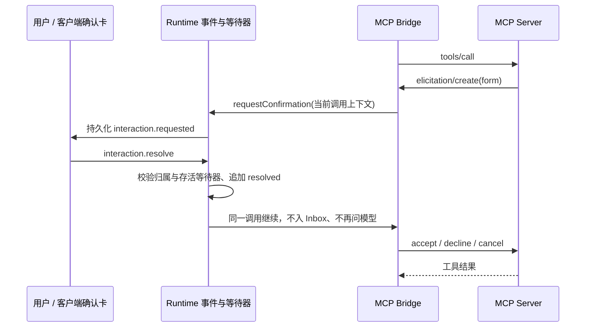

# MCP 原生确认桥接（2026-09-12）

背景：Monery 的 prepare/commit 已有严格确认和幂等，但 Harness 未声明 elicitation，Charlie 无法完成记账。用户要求实际跑通。只记录账本，不执行券商交易。

组件：`mcp/elicitation.ts` 做协议适配和调用关联；`McpManager` 声明 form 能力，在实例独占调用内绑定上下文；`RuntimeService` 持有短生命周期确认等待器，事件日志仍是审计来源；共享 UI 复用确认卡，展示完整原文和服务名称。无数据库迁移、无第二 Driver。

当前仅支持一个 boolean 字段的确认型 form，满足 Monery 的 confirm；其他字段/URL mode 明确拒绝，不索取秘密、不猜字段。忽略默认勾选，必须明确点击。Monery 提示限制 32 KiB，Harness 加来源包装后限制 36 KiB；最多四次询问/工具调用，串行关联当前连接；空闲请求拒绝，不能跨 Session 回答。SDK 1.30.0，协议依照 [2025-11-25 elicitation](https://modelcontextprotocol.io/specification/2025-11-25/client/elicitation)。不跟随 draft 协议重写传输。

复用已有 `interaction.requested(kind=approval, schema={type:boolean,x-harness-source:mcp})`，无需改变 API v2。扩展标记只由宿主回调生成；普通模型问答仍入 Inbox。原生确认不授予工具权限，full-access 和通用批准不代答。服务器内容以纯文本完整展示，不作为指令。

等待限于单次工具存活期；保留 MCP 90 秒无进度/10 分钟硬上限。取消、断连、超时、服务关闭使确认失效；重启清理 pending，不重放副作用。已提交后响应丢失由 Monery 原 draft/idempotency 核对，不自动补单。

## 先行测试清单

|编号|场景|预期|
|---|---|---|
|EL-01|真实 SDK 发起确认|接受返回精确 boolean；默认 true 不能自动同意|
|EL-02|拒绝、取消|返回 decline/cancel，无接受结果|
|EL-03|空闲/无宿主/未知表单/超限请求|失败关闭，不伪造交互|
|EL-04|同时或跨调用请求、取消后迟到响应|不串用户/Session，不复用旧授权|
|EL-05|Runtime 原生确认|同一 Tool Call 等待，先记 resolved 再继续；不入 Inbox、不增加一次 LLM|
|EL-06|错用户、错会话、重复响应、非 boolean|归属和幂等正确；非法输入不消费请求|
|EL-07|运行取消/重启|交互失效，不重放未知写入|
|EL-08|共享 UI|完整草稿、服务来源、拒绝/取消/确认可见，正文不是 HTML|
|EL-09|服务器闭环|隔离 MySQL + 实际 Harness/MCP 完成新增、买入、减仓、定投和回读；真实资产不变|

上线前构建、定向回归，保留现有脏工作树；使用独立发布目录和升级前备份，不覆盖旧包。先隔离验收再切换已授权服务。真实模型只用合成验收数据；测试客户端只能批准已核对的测试库草稿，生产确认不能由测试程序代答。

## 执行结果

- 新增 7 项协议适配单测、7 项真实 SDK/Runtime 集成测试全部通过；全量 75 文件、428 通过、2 个平台项跳过。TypeScript、变更文件 ESLint、Server/Web 构建通过。
- 服务器补丁 `20260912T102500Z-mcp-confirmation` 已运行；四个真实 Charlie 场景完成场外买入、ETF 买入/减仓、定投创建及余额回读。测试确认客户端严格比对 TEST_ONLY 草稿，正式 Monery 保持未初始化。
- 原生确认复用现有 Interaction 卡，API v2 不变；本轮浏览器控制超时，未宣称完成真人鼠标点击验收。对话/API 原生确认和拒绝/超时/重启已验证。
- 详见 Monery 仓库 `docs/仓位操作模块/服务器部署测试.md`，包含会话 ID、隔离库、失败重试、备份和还原说明；临时模型及绑定已恢复，测试服务停止，合成记录保留。
